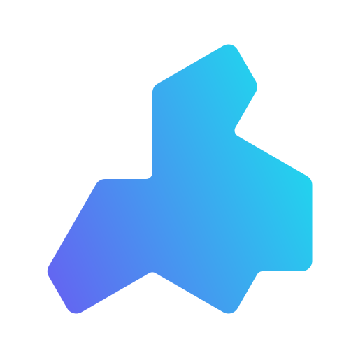

<div align="center">

<picture>
  <source media="(prefers-color-scheme: dark)" srcset="assets/logo-dark.svg" />
  
</picture>

# Tessera

[![简体中文][readme-cn-badge]][readme-cn-url]
[![doc][doc-badge]][doc-url]
[![Stars][stars-badge]][stars-url]
[![CI][ci-badge]][ci-url]


A fast, GPU-first Rust UI framework that is declarative and reactive.

</div>

[doc-badge]: https://img.shields.io/github/actions/workflow/status/tessera-ui/tessera-ui.github.io/.github/workflows/docs.yml?style=for-the-badge&label=doc
[doc-url]: https://tessera-ui.github.io/
[readme-cn-badge]: https://img.shields.io/badge/README-简体中文-blue.svg?style=for-the-badge
[readme-cn-url]: https://github.com/tessera-ui/tessera/blob/main/docs/README_zh-CN.md
[stars-badge]: https://img.shields.io/github/stars/tessera-ui/tessera?style=for-the-badge
[stars-url]: https://github.com/tessera-ui/tessera
[ci-badge]: https://img.shields.io/github/actions/workflow/status/tessera-ui/tessera/ci.yml?style=for-the-badge&label=CI
[ci-url]: https://github.com/tessera-ui/tessera/actions/workflows/ci.yml

## Features

- **[Cross-platform](https://tessera-ui.github.io/guide/platforms)**: runs on Windows, macOS, Linux, Android, iOS and the web.
- **[Platform plugins](https://tessera-ui.github.io/guide/plugins)**: write a platform plugin to call APIs only one platform has.
- **[Reactive](https://tessera-ui.github.io/guide/state)**: no state notifications to keep in sync by hand.
- **[Bring your own shader](https://tessera-ui.github.io/guide/drawing)**: every effect is a pluggable shader, the built-in component library included.
- **[Modern scaffolding](https://tessera-ui.github.io/guide/cli)**: `cargo-tessera` is all you need, for everything.
- **[Pure Rust](https://tessera-ui.github.io/guide/thinking-in-tessera)**: plain Rust syntax, 0% RSX.

If you encounter any issues, please feel free to [submit an issue](https://github.com/tessera-ui/tessera/issues).

## Write a function. Tessera draws the rest.

```rust
use tessera_components::{
    alignment::{CrossAxisAlignment, MainAxisAlignment},
    column::column,
    md3::{button::button, surface::surface, text::text, theme::material_theme},
};
use tessera_foundation::modifier::ModifierExt as _;
use tessera_ui::{Dp, Modifier, remember, tessera};

#[tessera]
pub fn app() {
    let count = remember(|| 0i32);

    material_theme().child(move || {
        surface()
            .modifier(Modifier::new().fill_max_size())
            .child(move || {
                column()
                    .modifier(Modifier::new().fill_max_size())
                    .main_axis_alignment(MainAxisAlignment::Center)
                    .cross_axis_alignment(CrossAxisAlignment::Center)
                    .children(move || {
                        text(count.get().to_string()).size(Dp(40.0));
                        button()
                            .filled()
                            .on_click(move || count.with_mut(|c| *c += 1))
                            .child(|| text("Increment"));
                    });
            });
    });
}
```

The UI is a Rust function of state. Tessera runs these functions as needed to
build each frame, then draws it on the GPU using Vulkan, Metal, DirectX 12 or
WebGPU. No HTML, no CSS, no WebView.

Calling a component registers one UI use and returns a typed configuration
handle. See [component calls](docs/COMPONENT_CALLS.md) for how handles,
deferred child content, and execution order work.

## Start a project

```sh
cargo install cargo-tessera
cargo tessera new my-app
cd my-app && cargo tessera dev
```

See the [getting started guide](https://tessera-ui.github.io/guide/getting-started)
for more, or [try the web demo](https://tessera-ui.github.io/tessera/example/).

## Contributing

Please read the [Contributing Guide](https://github.com/tessera-ui/tessera/blob/main/CONTRIBUTING.md) to learn how to contribute to the project.

## Acknowledgements

- [wgpu](https://github.com/gfx-rs/wgpu), a powerful graphics API abstraction layer.
- [winit](https://github.com/rust-windowing/winit), a cross-platform windowing and event handling library.
- [glyphon](https://github.com/grovesNL/glyphon), a text rendering solution.
- Original logo design by [@ktechhydle](https://github.com/ktechhydle).

## License

Tessera is dual-licensed under the [MIT License](https://github.com/tessera-ui/tessera/blob/main/LICENSE-MIT) or the [Apache 2.0 License](https://github.com/tessera-ui/tessera/blob/main/LICENSE-APACHE).

## Star History

<a href="https://www.star-history.com/#tessera-ui/tessera&Date">
 <picture>
   <source media="(prefers-color-scheme: dark)" srcset="https://api.star-history.com/svg?repos=tessera-ui/tessera&type=Date&theme=dark" />
   <source media="(prefers-color-scheme: light)" srcset="https://api.star-history.com/svg?repos=tessera-ui/tessera&type=Date" />
   
 </picture>
</a>
