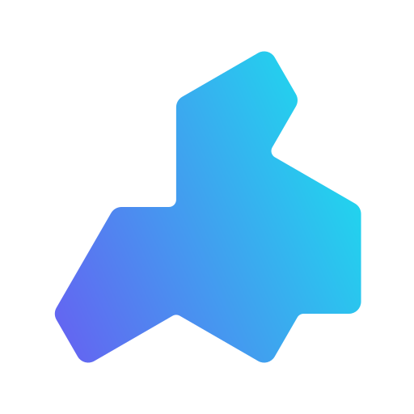

<div align="center">

<picture>
  <source media="(prefers-color-scheme: dark)" srcset="../assets/logo-dark.svg" />
  
</picture>

# Tessera

[![English][readme-en-badge]][readme-en-url]
[![doc][doc-badge]][doc-url]
[![Stars][stars-badge]][stars-url]
[![CI][ci-badge]][ci-url]


快速、GPU 优先的 Rust UI 框架，声明式且响应式。

</div>

[doc-badge]: https://img.shields.io/github/actions/workflow/status/tessera-ui/tessera-ui.github.io/.github/workflows/docs.yml?style=for-the-badge&label=doc
[doc-url]: https://tessera-ui.github.io/
[readme-en-badge]: https://img.shields.io/badge/README-English-blue.svg?style=for-the-badge
[readme-en-url]: https://github.com/tessera-ui/tessera/blob/main/README.md
[stars-badge]: https://img.shields.io/github/stars/tessera-ui/tessera?style=for-the-badge
[stars-url]: https://github.com/tessera-ui/tessera
[ci-badge]: https://img.shields.io/github/actions/workflow/status/tessera-ui/tessera/ci.yml?style=for-the-badge&label=CI
[ci-url]: https://github.com/tessera-ui/tessera/actions/workflows/ci.yml

## 特性

- **[跨平台支持](https://tessera-ui.github.io/zhHans/guide/platforms)**：支持 Windows、macOS、Linux、Android、iOS 和 Web。
- **[平台插件](https://tessera-ui.github.io/zhHans/guide/plugins)**：编写平台插件，调用平台特有的 API。
- **[响应式](https://tessera-ui.github.io/zhHans/guide/state)**：无需维护复杂的状态通知。
- **[自定义着色器](https://tessera-ui.github.io/zhHans/guide/drawing)**：用插件式着色器编写一切效果，内置组件库也不例外。
- **[现代的脚手架](https://tessera-ui.github.io/zhHans/guide/cli)**：仅需 `cargo-tessera` 便可完成一切操作。
- **[纯粹的 Rust](https://tessera-ui.github.io/zhHans/guide/thinking-in-tessera)**：纯粹的 Rust 语法，0% RSX。

如果您在使用过程中遇到任何问题，请随时[提交 issue](https://github.com/tessera-ui/tessera/issues)。

## 写一个函数，剩下的交给 Tessera 绘制

```rust
use tessera_components::{
    alignment::{CrossAxisAlignment, MainAxisAlignment},
    column::column,
    md3::{button::button, surface::surface, text::text, theme::material_theme},
};
use tessera_foundation::modifier::ModifierExt as _;
use tessera_ui::{Dp, Modifier, remember, tessera};

#[tessera]
pub fn app() {
    let count = remember(|| 0i32);

    material_theme().child(move || {
        surface()
            .modifier(Modifier::new().fill_max_size())
            .child(move || {
                column()
                    .modifier(Modifier::new().fill_max_size())
                    .main_axis_alignment(MainAxisAlignment::Center)
                    .cross_axis_alignment(CrossAxisAlignment::Center)
                    .children(move || {
                        text(count.get().to_string()).size(Dp(40.0));
                        button()
                            .filled()
                            .on_click(move || count.with_mut(|c| *c += 1))
                            .child(|| text("Increment"));
                    });
            });
    });
}
```

界面是关于状态的 Rust 函数。Tessera 按需执行它们来构建每帧，并通过 GPU 在
Vulkan、Metal、DirectX 12 或 WebGPU 上绘制。没有 HTML，没有 CSS，没有 WebView。

调用组件会登记一次 UI 使用，并返回带类型的配置句柄。句柄、延迟子内容和执行顺序详见
[组件调用](COMPONENT_CALLS.md)。

## 创建项目

```sh
cargo install cargo-tessera
cargo tessera new my-app
cd my-app && cargo tessera dev
```

更多内容请参考[快速开始指南](https://tessera-ui.github.io/zhHans/guide/getting-started)，
或[体验 Web 示例](https://tessera-ui.github.io/tessera/example/)。

## 贡献

请阅读 [贡献指南](https://github.com/tessera-ui/tessera/blob/main/docs/CONTRIBUTING_zh-CN.md) 了解如何为项目做出贡献。

## 致谢

- [wgpu](https://github.com/gfx-rs/wgpu)，强大的图形 API 抽象层。
- [winit](https://github.com/rust-windowing/winit)，跨平台窗口和事件处理库。
- [glyphon](https://github.com/grovesNL/glyphon)，文本渲染解决方案。
- 原始 Logo 设计由 [@ktechhydle](https://github.com/ktechhydle) 完成。

## 许可证

Tessera 采用 [MIT 许可证](https://github.com/tessera-ui/tessera/blob/main/LICENSE-MIT) 或 [Apache 2.0 许可证](https://github.com/tessera-ui/tessera/blob/main/LICENSE-APACHE)双重许可。

## Star History

<a href="https://www.star-history.com/#tessera-ui/tessera&Date">
 <picture>
   <source media="(prefers-color-scheme: dark)" srcset="https://api.star-history.com/svg?repos=tessera-ui/tessera&type=Date&theme=dark" />
   <source media="(prefers-color-scheme: light)" srcset="https://api.star-history.com/svg?repos=tessera-ui/tessera&type=Date" />
   
 </picture>
</a>
